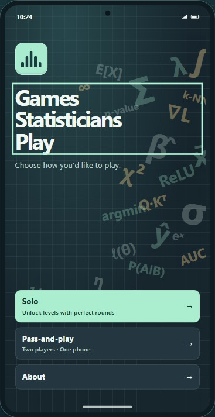
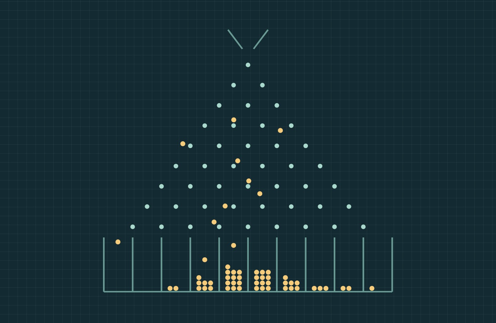
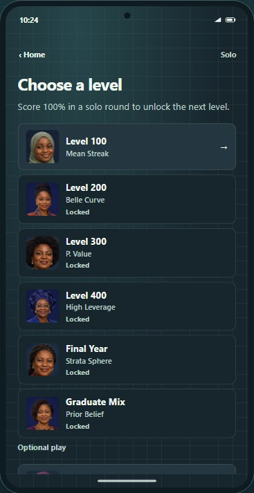
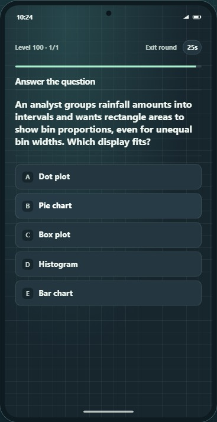
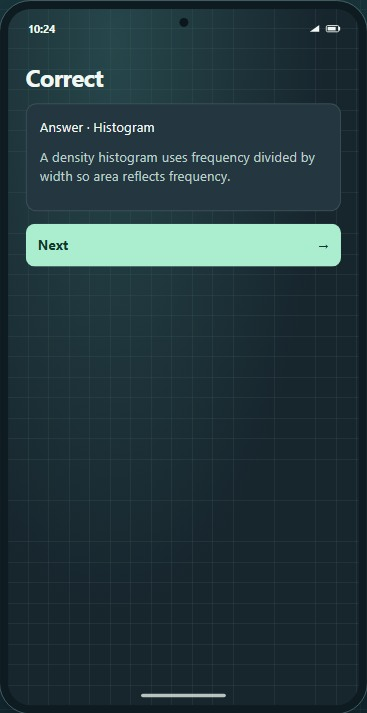
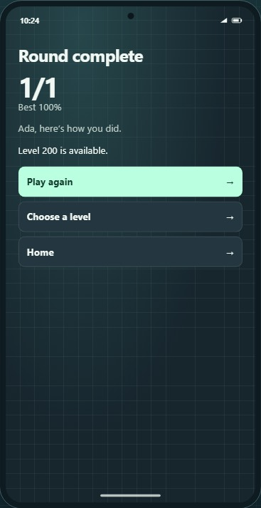
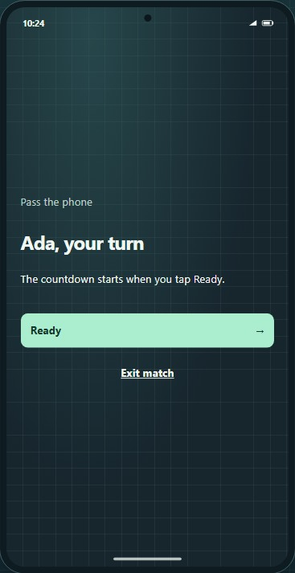
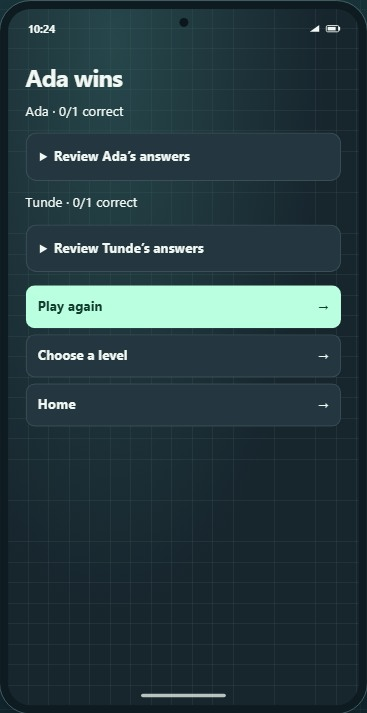
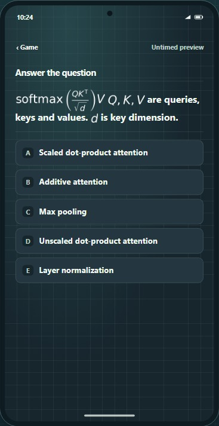
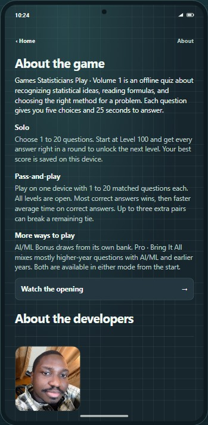

# Games Statisticians Play (Volume 1)

An offline statistics quiz for solo practice or a two-player match on one device. Read a
clue, recognize the statistical idea, formula or distribution, and choose from five answers
within 25 seconds.

[Watch the gameplay demo](docs/media/gameplay-demo.mp4) ·
[Open the offline phone preview](preview/index.html) · [Download](#download) · [How to play](#how-to-play)



## Download

- **Browser edition** for phones and computers. [Download the browser game ZIP](https://github.com/batestguy/games-stats-playV1/archive/refs/heads/main.zip).
  Extract it, keep the files in `preview/` together, and open `preview/index.html` in a browser.
- **Android test build** for ARM phones running Android 8 or later. [Download the v0.1.0 APK](https://github.com/batestguy/games-stats-playV1/releases/download/v0.1.0-internal/games-statisticians-play-0.1.0-internal-debug.apk).
  It is a debug prerelease. [Release notes and checksum](https://github.com/batestguy/games-stats-playV1/releases/tag/v0.1.0-internal)

## Why play?

Statistics often asks you to connect a problem with a method and make sense of its notation.
The game lets learners practice that step in short rounds. A clue might describe an idea in
words, present a situation, or ask you to recognize an equation. The five choices give you a
chance to distinguish related ideas, and feedback gives you something to review after each
answer.

The solo ladder starts with introductory material and brings earlier topics back as you
advance. A shared-device match gives classmates a way to compare answers and discuss
the explanations afterward. The Galton board opening shows how many individual paths
through pegs can form a distribution in the collection bins. The game is designed as a
companion to coursework and worked examples.

## Watch the demo

[](docs/media/gameplay-demo.mp4)

The demo follows the offline browser simulator from the Galton board opening through
solo play, feedback and a level unlock, then through a two-player match and its answer
review. It also shows the optional levels, About and the simulator controls. A highlighted
pointer makes taps and clicks visible. Soundtrack credit goes to The Alan Parsons Project
for the supplied recording of **“Games People Play.”**

| Time | Activity |
| --- | --- |
| 0:00 | Galton board opening |
| 0:11 | Solo setup, answers, feedback, level unlock and exit |
| 0:38 | AI/ML Bonus, hints and the full countdown |
| 1:18 | Pro match, private handover, tiebreak and review |
| 1:56 | Formula, screen sizes, themes and launcher icons |
| 2:24 | About, developer credits and opening replay |
| 2:42 | Why the game matters |
| 2:47 | Soundtrack credit |

## Get started

### Browser phone preview

Download or clone this repository, keep the contents of the preview folder together and
open [preview/index.html](preview/index.html) in a browser with JavaScript enabled. Both
game modes work offline. The browser keeps solo progress and the nickname in local storage
when available and uses temporary in-memory progress if storage is blocked. Browser
progress and Windows progress are stored separately.

### Windows

Use the existing conda environment, which includes Kivy 2.3.1 and pytest. From the project
root, open PowerShell and start the game with these commands.

```powershell
conda activate appdev-conda
python app/main.py
```

### Android internal test build

Version 0.1.0 is a debug prerelease for ARM phones running Android 8 (API 26) or later.
Get the APK from [Download](#download), then open it on the test phone to install.
The [Android prototype workflow](.github/workflows/android-prototype.yml) can build a
fresh APK from source. The current package passed signature and bundled asset checks,
and the project owner reported that the APK worked on their phone. The full
[handset checklist](#android-phone-check) remains open.
[Build details and checksum](HANDOFF.md#remaining-release-work)

## How to play

### Start a round

1. Wait for the 10-second Galton board opening to advance to Home. Choose **Solo** or
   **Pass-and-play**.
2. Choose a level. The list shows a World Statistics Secretary for each of the six
   statistics levels and the two optional modes.
3. Enter a whole number from 1 to 20. The default is 10 questions in solo and 10 per
   player in pass-and-play. You can add one solo nickname or two match nicknames.
   The game remembers the solo nickname on the current device or browser.
4. Select **Start round** or **Start match**.



### Solo

1. On your first visit choose **Level 100** or one of the optional modes. Tap one of the
   five choices before the 25-second countdown ends. A correct answer earns one point.
   A wrong answer or timeout earns zero.
2. Read the explanation for a correct answer or the hint for a missed question, then tap
   **Next**. You can pause on the feedback screen before the next question begins.
3. Finish the round to see your accuracy. Get every question right on a statistics level
   to unlock the next one. The ladder runs through Level 100, Level 200, Level 300,
   Level 400, Final Year and Graduate Mix.
4. Replay the level, choose another level or return home from the results screen. The
   game saves your best completed accuracy for each level. To stop a round in progress,
   choose **Exit round** and confirm. An unfinished round leaves the best score unchanged.







### Pass-and-play

1. Choose **Pass-and-play** and select a level for both players. Every level is open in
   this mode. Enter the number of questions per player and two optional nicknames.
   Blank names use **Player 1** and **Player 2**.
2. Select **Start match** and give the device to the player named on the handover screen.
   That player taps **Ready** to see their question and start a fresh 25-second countdown.
3. After an answer or timeout, hand over the device when prompted. The previous question
   and choices disappear before the next player sees **Ready**. Both players receive the
   same mix of source levels and each pair uses different concepts of the same difficulty,
   source level and clue type.
4. When the match ends, check the winner and each player's score. In the browser, open
   each **Review …’s answers** section for feedback. In the Windows app, scroll down
   to see both reviews. Select the replay option, choose a level or return home.
   Use **Exit match** and confirm to leave a match in progress.

The higher score wins, followed by the faster average time on correct answers if scores
are equal. A remaining tie uses up to three matched reserve pairs. The first pair with
exactly one correct answer decides the match. If all three pairs tie, the match ends in
a draw.





### Optional modes and question mixes

| Level or mode | Where questions come from |
| --- | --- |
| Level 100 | Its own question bank. |
| Level 200 through Graduate Mix | About 80% from the selected level and 20% from a combined pool of earlier levels. The review share rounds to the nearest whole question. A 10-question round uses 8 current and 2 review questions. |
| **AI/ML Bonus** | Only artificial intelligence and machine learning questions. |
| **Pro · Bring It All** | About 70% from Level 400, Final Year and Graduate Mix, 20% from AI/ML and 10% from Levels 100–300. Ten questions use 7, 2 and 1 respectively. Randomized rounding keeps every pool eligible in a one-question round. |

**AI/ML Bonus** and **Pro · Bring It All** are open from the start in both modes. Each
has its own solo best score. Each round draws without repeat questions, and the five
answer choices appear in shuffled order. In a match, reserve pairs come from the chosen
year, AI/ML for that mode, or Pro's higher-year pool.

### Simulator controls

The **Preview controls** beside the phone let you compare compact, standard and large
phone sizes, portrait and landscape, and 100%, 130% or 160% text. Switch between the
**Graph**, **Solid** and **Paper** backgrounds and the **Histogram** and **Sigma** app
icons.

- Choose **Inspect a formula** to try an untimed sample and see its feedback.
- Choose **Open launcher preview** to see the selected app icon on the simulated launcher.
  Select the game icon to return.
- Choose **Return to game** to leave either preview. If you open a preview during a live
  question, its timer keeps running.



### About and credits

From Home, choose **About** for the game rules and developer profiles. Choose
**Watch the opening** to replay the Galton board and return to About. The developers are
Jerry Bannister Zachary and Yusuf Strong Mashat. [Thoughts by Your Hommie](https://batestguy.github.io/QuartoWebsite-blog-others/about.html) ·
[Strong’s research](https://www.researchgate.net/profile/Strong-Mashat)



## Development and verification

| Where | Purpose |
| --- | --- |
| [app/main.py](app/main.py) | Kivy screens, opening, handover and platform timing. |
| [app/game.py](app/game.py) | Question draws and pairing, scoring and saved progress. |
| [app/assets](app/assets) | Bundled question banks, equations and portraits. |
| [preview/game.js](preview/game.js) and [preview/preview.js](preview/preview.js) | Browser game rules, screens and simulator controls. |
| [buildozer.spec](buildozer.spec) | Internal Android package ID and build configuration. |
| [Project handoff](HANDOFF.md) | Verification history and release work. |

Run the Windows suite from the project root in the conda environment. The temporary
directory and cache setting below avoid the Windows access errors recorded in the handoff.

```powershell
conda activate appdev-conda
$testTemp = Join-Path $env:TEMP ('statsgame-test-' + [guid]::NewGuid().ToString('N'))
python -m pytest -q -p no:cacheprovider --basetemp $testTemp
```

The handoff records 31 passing tests. They cover all round lengths from 1 to 20 across
the six levels and both optional modes, including shuffling, matched turns, timeouts,
tiebreaks, unlocks and loading older saved progress. Offline Chromium checks covered
both orientations at all simulated sizes and formula rendering at 160% text.
[Automated tests](tests/test_game.py) · [Verification notes](HANDOFF.md#verification-and-working-files)

## Android phone check

Use the debug prerelease above. To build a fresh copy, run **Android prototype**
in GitHub Actions on a standard Ubuntu runner with included build capacity. Download the
workflow artifact, extract the APK and transfer it privately to the test phone. The workflow
stores an internal artifact for seven days. [Android prototype workflow](.github/workflows/android-prototype.yml) ·
[Android packaging for Kivy](https://kivy.org/doc/stable/guide/packaging-android.html) ·
[GitHub Actions billing and usage](https://docs.github.com/en/actions/concepts/billing-and-usage)

Record the APK version, phone model, Android version, text and display settings, and
TalkBack version for each run.

1. Install the APK and launch it in airplane mode. Confirm the Galton board fills the game
   screen and advances automatically after 10 seconds. Replay it from About and confirm
   the app returns to About. Finish a round in each mode and check optional nicknames
   on the handover and results screens.
2. With TalkBack on, swipe through the title, clue and choices. Confirm it reads formulas
   and gives all five answers meaningful names, and that a double tap submits the
   focused answer once.
3. Set system text and display size to their largest settings. Test formula questions in
   both orientations. Check for missing glyphs, clipping and answer wrapping that singles
   out the correct choice. On Android 16, check that the timer and controls clear the
   system bars with both gesture and three-button navigation.
4. Rotate while a question is active. Switch away and return after the 25-second deadline.
   Confirm that the timeout is recorded once.
5. On the handover screen, confirm visually and with TalkBack that the previous question
   and choices are gone. Wait more than 25 seconds before tapping **Ready** and confirm
   the next player receives the full countdown.
6. Compare the chosen launcher icon and background on the phone in light and dark
   system settings.

Kivy's standard widgets have an open accessibility support issue. The handset check
remains pending. If a focused Kivy fix fails, switch to the approved TypeScript and
Capacitor approach and rerun the same device checks.
[Kivy accessibility issue](https://github.com/kivy/kivy/issues/8596) ·
[Android TalkBack testing](https://developer.android.com/guide/topics/ui/accessibility/testing) ·
[Capacitor Android](https://capacitorjs.com/docs/android)

## Curriculum

Questions ask players to recognize an equation, concept, or distribution. Equation prompts and choices display with LaTeX typesetting in both offline editions.

The [coverage map](curriculum/coverage.v1.json) links all 1,050 draft questions to 30 learning outcomes. Each of the seven authored categories has 150 questions. Pro draws from those banks. The expansion directs more new questions to outcomes with fewer existing items. Statistics questions use the fourth edition of the Cambridge Dictionary of Statistics with printed page references where available. AI/ML questions use course notes, textbooks and original papers. Review the questions for correctness, a single best answer and clues from length, wording or notation. [Waterloo multiple-choice design guide](https://uwaterloo.ca/centre-for-teaching-excellence/catalogs/tip-sheets/designing-multiple-choice-questions)

| Level | Questions authored for this level | Curriculum sources |
| --- | ---: | --- |
| 100 | 150 | [UC Berkeley STAT 2](https://stat2.berkeley.edu/fall-2024/) |
| 200 | 150 | [MIT 18.05](https://ocw.mit.edu/courses/18-05-introduction-to-probability-and-statistics-spring-2022/pages/syllabus/), [UC Berkeley STAT 2](https://stat2.berkeley.edu/fall-2024/) |
| 300 | 150 | [Open University M248](https://www.open.ac.uk/courses/qualifications/details/m248/), [UC Berkeley STAT 2](https://stat2.berkeley.edu/fall-2024/) |
| 400 | 150 | [Open University M348](https://www.open.ac.uk/courses/modules/m348/), [Penn State STAT 502](https://online.stat.psu.edu/stat502/Lesson03) |
| Final Year | 150 | [Wharton statistics courses](https://statistics.wharton.upenn.edu/programs/undergraduate/course-descriptions/), [Penn EPID 702](https://www.med.upenn.edu/bgs/assets/user-content/documents/spring-2021-courses/21a-epid-702-syllabus.pdf), [Maryland SURV 701](https://jpsm.umd.edu/sites/jpsm.umd.edu/files/syllabi/SURV701_Online_Winter2018_v1.pdf), [UC Berkeley STAT C245C](https://www.stat.berkeley.edu/~sandrine/Teaching/syllabus_PHC240C_F18.pdf) |
| Graduate Mix | 150 | [Open University M347](https://css2.open.ac.uk/outis/descs/courses/M347.htm), [Ohio State STAT 6570](https://stat.osu.edu/sites/default/files/2024-02/Spring%202024%20STAT%206570%20syllabus%20for%20insructor%20Chkrebtii.pdf) |
| AI/ML Bonus | 150 | [UC Berkeley CS 188](https://inst.eecs.berkeley.edu/~cs188/textbook/), [An Introduction to Statistical Learning](https://www.statlearning.com/), [Speech and Language Processing](https://web.stanford.edu/~jurafsky/slp3/), [Attention Is All You Need](https://arxiv.org/abs/1706.03762) |
| **Total** | **1,050** | |

The release check requires at least 150 questions in each authored category and a curriculum outcome for every question. After independent content review, record the reviewed bank's fingerprint in the coverage map and run the check. The fingerprint combines the filenames and SHA-256 checksums of all bundled question files. Any edit to those files requires a new review of the changes and an updated fingerprint.

```powershell
python -m curriculum.check_release app/assets curriculum/coverage.v1.json
```

When editing a displayed equation, keep the plain clue, choice, or explanation as a text fallback. Use `math_clue` or `math_explanation` for prose with LaTeX enclosed in single dollar signs. In `math_choices`, map each plain choice to either a full LaTeX expression or prose with dollar-delimited LaTeX. Use a Python environment with Matplotlib to regenerate the offline typesetting and browser bank.

```powershell
python -m curriculum.render_equations
python -m preview.sync_bank
```

## Release status

The Windows build and browser preview are playable, and the Android debug prerelease
has passed package verification. The 1,050-question bank is still a draft and
requires independent approval. The signed public release follows that approval and handset
testing, including Android 8 and a recent Android release, 16 KB memory-page compatibility
and a signed update that preserves progress. Keep the release signing key and its encrypted
backup outside the workspace. [Release steps](HANDOFF.md#remaining-release-work) ·
[Android page-size checks](https://developer.android.com/guide/practices/page-sizes) ·
[Android app signing](https://developer.android.com/studio/publish/app-signing)
